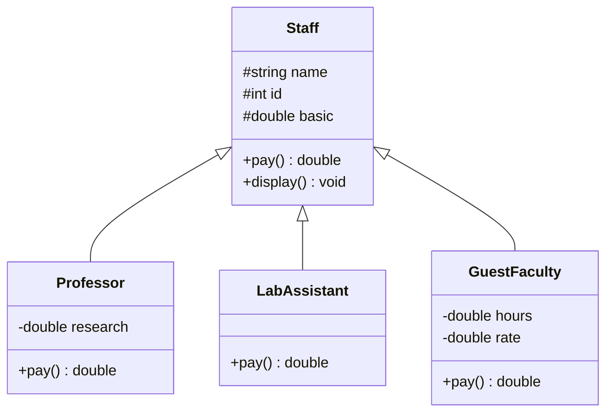
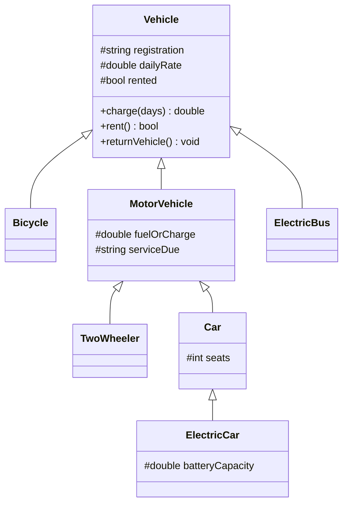

# ASSIGNMENT 4 – CO4
## Designing Reusable Class Hierarchies
**Course:** Object Oriented Programming with C++ (DSA01)  
**Course Outcome:** CO4 – Reusable class hierarchies, inheritance, virtual base classes, abstract classes, pointers and polymorphism

> Compile examples using: `g++ -std=c++17 -Wall -Wextra file.cpp -o program`

---

## TASK 1 – CLASS DESIGN REVIEW

### 1.1 Diagnose the Design

1. `name`, `id`, and `basic` are duplicated in `Professor` and `LabAssistant`.
2. The pay calculation `basic + basic * 0.42` is repeated.
3. Data members are public, so any code can modify them without validation.
4. Inconsistent names (`name`/`nm`, `id`/`code`) make the classes harder to use consistently.
5. `da` is declared but never used in the pay calculation.
6. The magic number `0.42` is hard-coded; a named constant would be clearer and easier to update.
7. Adding a staff category requires another separate class and makes handling all staff in one loop difficult.

### 1.2 Repaired Design

```cpp
#include <iostream>
#include <string>
using namespace std;

class Staff {
protected:
    string name;
    int id;
    double basic;

public:
    Staff(string n, int i, double b) : name(n), id(i), basic(b) {}
    virtual double pay() const = 0;
    virtual void display() const {
        cout << name << " (" << id << ") Pay: " << pay() << '\n';
    }
    virtual ~Staff() = default;
};

class Professor : public Staff {
    double research;
public:
    Professor(string n, int i, double b, double r)
        : Staff(n, i, b), research(r) {}
    double pay() const override { return basic * 1.42 + research; }
};

class LabAssistant : public Staff {
public:
    LabAssistant(string n, int i, double b) : Staff(n, i, b) {}
    double pay() const override { return basic * 1.42; }
};

class GuestFaculty : public Staff {
    double hours, rate;
public:
    GuestFaculty(string n, int i, double h, double r)
        : Staff(n, i, 0), hours(h), rate(r) {}
    double pay() const override { return hours * rate; }
};
```

### UML Class Diagram



### 1.3 Design Defence

The common `Staff` base class stores shared data and defines the common interface. Each derived class implements its own `pay()` function. When a new category is added, it can inherit from `Staff` and provide its own pay calculation without modifying the existing classes. This reduces duplication and supports polymorphic processing through base-class pointers.

### Alternative: One `Staff` Class with a Type and Switch

A single class could store a staff type and use a `switch` statement in `pay()`. Both designs take **O(1)** time per pay calculation. The single-class approach may store fields that are unused for some staff types. Adding a new category requires changing the type definition, the switch statement, and possibly constructors or other functions. With inheritance, a new derived class can be added without editing existing staff classes.

---

## TASK 2 – FROM REQUIREMENT TO HIERARCHY

### 2.1 Relationships

| Relationship | Type | Inheritance |
|---|---|---|
| Student is a Person | Is-a | Single |
| Staff is a Person | Is-a | Single |
| TeachingAssistant is a Student and Staff | Is-a | Multiple; virtual inheritance creates a diamond |
| ResearchScholar is a Student | Is-a | Multilevel |
| Person has an address (if included) | Has-a | Composition |

The overall structure is hybrid inheritance because it combines hierarchical, multiple and multilevel inheritance.

### 2.2 Diamond Problem

If `Student` and `Staff` both inherit normally from `Person`, then `TeachingAssistant` receives two separate `Person` subobjects. This can make accessing `name` ambiguous and duplicates the common base.

Using `virtual public Person` in both `Student` and `Staff` makes `TeachingAssistant` share one `Person` base subobject.

### 2.3 Class Declarations

```cpp
#include <string>
using namespace std;

class Person {
public:
    string name;
    int id;
    string phone;
    Person(string n, int i, string p) : name(n), id(i), phone(p) {}
    virtual ~Person() = default;
};

class Student : virtual public Person {
public:
    string program;
    double cgpa;
    Student(string n, int i, string p, string prog, double g)
        : Person(n, i, p), program(prog), cgpa(g) {}
};

class Staff : virtual public Person {
public:
    string department;
    double salary;
    Staff(string n, int i, string p, string d, double s)
        : Person(n, i, p), department(d), salary(s) {}
};

class TeachingAssistant : public Student, public Staff {
public:
    TeachingAssistant(string n, int i, string p, string prog, double g,
                    string d, double s)
        : Person(n, i, p), Student(n, i, p, prog, g),
          Staff(n, i, p, d, s) {}
};

class ResearchScholar : public Student {
public:
    double fellowship;
    ResearchScholar(string n, int i, string p, string prog, double g, double f)
        : Person(n, i, p), Student(n, i, p, prog, g), fellowship(f) {}
};
```

**Inheritance choice:** Public inheritance is used because the derived classes represent genuine “is-a” relationships and should retain the public interface of their base classes.

### 2.4 Access Table

| Member in `Person` | Public inheritance | Protected inheritance | Private inheritance |
|---|---|---|---|
| Public | Public | Protected | Private |
| Protected | Protected | Protected | Private |
| Private | Not directly accessible | Not directly accessible | Not directly accessible |

### Predict the Output

**Predicted output:**
```text
Person Student
Staff TA
```

`Person` is printed once because it is a virtual base class shared by `Student` and `Staff`. Construction order is virtual base first, then direct base classes in declaration order (`Student`, `Staff`), then `TeachingAssistant`.

If `virtual` is removed, there are two `Person` subobjects. The expected output becomes:
```text
Person Student
Person Staff TA
```
There is no required compiler error for this program; the duplicated `Person` construction is valid. Accessing a shared `Person` member through `TeachingAssistant` may become ambiguous.

### Alternative: Composition Instead of Inheritance

If `TeachingAssistant` contains `Student` and `Staff` objects, it has-a relationships rather than is-a relationships. With ordinary non-virtual `Person` inheritance inside each member, the object contains two `Person` subobjects. With virtual inheritance, the composition may still share a `Person` only within a single combined inheritance object; separate contained `Student` and `Staff` objects each own their own virtual-base instance. Composition makes member access explicit (`ta.student.name`, `ta.staff.department`) and avoids inheritance ambiguity, but duplicates data and adds object storage. Access time to a member is O(1) in either design; object space is larger with two contained objects.

---

## TASK 3 – CONSTRUCTORS IN DERIVED CLASSES AND MEMBER CLASSES

### 3.1 Base Constructor Calls

In virtual inheritance, the **most-derived class** is responsible for constructing the virtual base. Therefore, `TeachingAssistant` must initialize `Person` directly.

Example initializer list:
```cpp
TeachingAssistant(...)
    : Person(name, id, phone),
      Student(name, id, phone, program, cgpa),
      Staff(name, id, phone, department, salary) {}
```

### 3.2 Member Classes

A class can contain another class as a member (composition). The member object's constructor is called from the containing class's initializer list.

Example:
```cpp
class Address {
    string city;
    int pin;
public:
    Address(string c, int p) : city(c), pin(p) {}
};

class Person {
    Address home;
public:
    Person(string city, int pin) : home(city, pin) {}
};
```

### 3.3 Construction and Destruction Order

**Construction order:**
1. Virtual base classes (once, first).
2. Direct base classes in the order listed in the class declaration.
3. Member objects in the order they are declared in the class.
4. Derived-class constructor body.

**Destruction order:** the reverse—derived destructor body, members in reverse declaration order, direct bases in reverse order, and virtual bases last.

### Experiment: Remove `virtual`

Without virtual inheritance, the `TeachingAssistant` object contains two `Person` subobjects, so `Person` is constructed twice. `sizeof(TeachingAssistant)` may increase because the duplicated base data and alignment are added. Exact size is implementation-dependent; record the actual value printed by your compiler.

### Predict the Output (Vehicle/Engine)

```text
Vehicle Engine Car | ~Car ~Engine ~Vehicle
```

`Vehicle` base is constructed first, then member `Engine`, then `Car`. Destruction reverses that order: `Car`, `Engine`, then `Vehicle`.

### Complete the Code – TODO 1

```cpp
Student(const std::string& n, int a, long long r, const std::string& c, int p)
    : Person(n, a), regNo(r), home(c, p) {}
```

The complete program:
```cpp
#include <iostream>
#include <string>
using namespace std;

class Person {
protected:
    string name;
    int age;
public:
    Person(const string& n, int a) : name(n), age(a) {}
};

class Address {
    string city;
    int pin;
public:
    Address(const string& c, int p) : city(c), pin(p) {}
    string str() const { return city + "-" + to_string(pin); }
};

class Student : public Person {
    long long regNo;
    Address home;
public:
    Student(const string& n, int a, long long r, const string& c, int p)
        : Person(n, a), regNo(r), home(c, p) {}
    void print() const {
        cout << regNo << ' ' << name << " (" << age << ") " << home.str() << '\n';
    }
};

int main() {
    Student s("Kavya", 19, 192311001, "Salem", 636001);
    s.print();
}
```

**Output**
```text
192311001 Kavya (19) Salem-636001
```

If initializer-list items are reordered, the compiler still initializes members in their declaration order, not the order written in the list. With `-Wall`, it may warn that the initializer order differs (`-Wreorder`).

### Alternative: Dynamically Allocated Address

If `Address* home` is allocated using `new`, the constructor must allocate it, the destructor must delete it, and the copy constructor/assignment must handle deep copying (or disable copying). Allocation adds runtime overhead and a pointer-sized field; the actual `Address` also occupies heap memory. A direct member object is simpler and safer when an address is always present.

---

## TASK 4 – POINTERS TO DERIVED CLASSES: FORENSICS

### 4.1 Defects

1. `rate()` is not virtual, so a call through `Account*` uses the base implementation (3.5), not `SeniorAccount`'s 4.0.
2. `Account` has a non-virtual destructor. Deleting a derived object through `Account*` is undefined behavior.
3. `SeniorAccount` allocates `history`, but deletion through the base pointer does not reliably invoke `SeniorAccount::~SeniorAccount()`, causing a memory leak/undefined behavior.
4. `Account copy = SeniorAccount();` causes object slicing: only the `Account` portion is copied.

### 4.2 Evidence

Compile with AddressSanitizer:
```bash
g++ -std=c++17 -Wall -Wextra -fsanitize=address -fno-omit-frame-pointer task4.cpp -o task4
./task4
```
Because deleting a derived object through a non-virtual base destructor is undefined behavior, sanitizer output can vary. Add destructor messages and use the corrected version below to verify the proper destruction order. Do not claim a fixed sanitizer message; paste the actual output from your run.

### 4.3 Corrected Program

```cpp
#include <iostream>
#include <memory>
using namespace std;

class Account {
public:
    virtual double rate() const { return 3.5; }
    virtual ~Account() = default;
};

class SeniorAccount : public Account {
    double* history;
public:
    SeniorAccount() : history(new double[100]{}) {}
    double rate() const override { return 4.0; }
    ~SeniorAccount() override { delete[] history; }
};

int main() {
    unique_ptr<Account> accounts[2];
    accounts[0] = make_unique<Account>();
    accounts[1] = make_unique<SeniorAccount>();

    for (const auto& a : accounts) cout << a->rate() << '\n';

    SeniorAccount senior;
    Account& ref = senior; // use a reference, not a sliced copy
    cout << ref.rate() << '\n';
}
```

Expected output:
```text
3.5
4
4
```

### 4.4 Prevention Rules

- Any polymorphic base class should have a virtual destructor.
- Use `override` for derived virtual functions so signature mistakes are caught.
- Prefer `std::unique_ptr` for owned polymorphic objects and avoid slicing by using references or pointers.

### Predict the Output

```text
3.5 4 3.5
```

- `p->rate()` is non-virtual, so it is bound at compile time to `Account::rate()` and returns 3.5.
- `p->vrate()` is virtual, so runtime dispatch calls `SeniorAccount::vrate()` and returns 4.0.
- `copy.vrate()` is called on a sliced `Account` object, so it returns 3.5.

### Alternative: `std::vector<std::unique_ptr<Account>>`

```cpp
vector<unique_ptr<Account>> accounts;
accounts.push_back(make_unique<Account>());
accounts.push_back(make_unique<SeniorAccount>());
```

Processing `n` accounts takes O(n) overall; one call to `charge()`/`rate()` is O(1). Space is O(n) for the objects and pointers. Smart pointers prevent manual-delete errors, but non-virtual functions still fail to dispatch polymorphically, and slicing can still occur if objects are copied by value into a base-class container.

---

## TASK 5 – POINTERS TO OBJECTS AND THE `this` POINTER

### 5.1 Four Ways to Access a Cart

```cpp
#include <iostream>
using namespace std;

class Cart {
    double amount = 100;
public:
    double total() const { return amount; }
};

int main() {
    Cart c;                         // (a) direct object
    cout << c.total() << '\n';

    Cart* p = &c;                   // (b) pointer with ->
    cout << p->total() << '\n';

    Cart& r = c;                    // (c) reference
    cout << r.total() << '\n';

    Cart* heap = new Cart;           // (d) dynamically allocated
    cout << heap->total() << '\n';
    delete heap;
}
```

### Method Chaining and `this`

`this` is a pointer to the current object. `*this` is the current object itself (an lvalue reference when returned as `Cart&`). Returning `*this` allows chaining without making a copy.

### 5.2 Find the Cart with the Highest Total

```cpp
Cart* carts[] = { /* pointers to existing Cart objects */ };
int count = 3;
int best = 0;

for (int i = 1; i < count; ++i)
    if (carts[i]->total() > carts[best]->total())
        best = i;

cout << "Highest cart index: " << best << '\n';
cout << "Highest total: " << carts[best]->total() << '\n';
```

### 5.3 Comparison

| Method | Safety/lifetime | Use |
|---|---|---|
| Object by name | Lifetime is scope-based; no null pointer | Preferred for local objects |
| Pointer (`->`) | Can be null; lifetime depends on what it points to | Optional access, polymorphism |
| Reference | Must refer to an object; cannot be reseated | Alias to an existing object |
| `new` + `delete` | Manual lifetime management; easy to leak | Avoid when smart pointers can be used |

### Complete the Code – TODO 1 and TODO 2

```cpp
Cart& add(const std::string& item, double price) {
    if (n < 10) {
        this->items[n] = item;
        this->prices[n] = price;
        ++n;
    }
    return *this;
}

Cart& setDiscount(double discount) {
    this->discount = discount;
    return *this;
}
```

Complete program:
```cpp
#include <iomanip>
#include <iostream>
#include <string>
using namespace std;

class Cart {
    string items[10];
    double prices[10];
    int n = 0;
    double discount = 0;

public:
    Cart& add(const string& item, double price) {
        if (n < 10) {
            this->items[n] = item;
            this->prices[n] = price;
            ++n;
        }
        return *this;
    }

    Cart& setDiscount(double discount) {
        this->discount = discount;
        return *this;
    }

    double total() const {
        double t = 0;
        for (int i = 0; i < n; ++i) t += prices[i];
        return t * (100 - discount) / 100;
    }
};

int main() {
    Cart c;
    c.add("Rice", 60).add("Dal", 120).setDiscount(10);
    Cart* p = &c;
    p->add("Oil", 180);
    cout << fixed << setprecision(2) << p->total() << '\n';
}
```

**Output**
```text
324.00
```

If `add()` returned `Cart` by value, every call would return a copy. Chaining could operate on temporary copies rather than the original object, and additional copying would occur. Returning `Cart&` returns the same object and avoids that copy.

### Alternative: `std::vector<Cart>`

Finding the highest total among `n` carts remains O(n) in either design. A vector of objects stores each `Cart` directly; a pointer array stores one pointer per cart, with objects elsewhere. Vector growth may reallocate its storage and invalidate pointers/references/iterators to its elements. Index-based access after growth is safer than retaining element pointers.

---

## TASK 6 – DESIGN CHALLENGE: VEHICLE RENTAL FLEET

### Stage 1 – Requirements and Testable Statements

**Entities and data**
- Vehicle: registration number, daily rate, rented/available status.
- Bicycle: common vehicle data.
- MotorVehicle: fuel/charge level, service due date.
- TwoWheeler: motor vehicle data.
- Car: motor vehicle data, seating capacity.
- ElectricCar: car data, battery capacity, charging-based energy information.
- Rental: rental days and late-return days (if needed).

**Testable requirements**
1. The fleet can list all vehicles.
2. A vehicle can be rented only if it is available.
3. Returning a vehicle makes it available again.
4. Each vehicle type computes its own rental charge.
5. Late return adds a late fee.
6. A new vehicle type can be introduced without editing existing vehicle classes.

### Stage 2 – Hierarchy



This is hierarchical, multilevel inheritance. `Vehicle` is abstract because `charge()` is pure virtual.

### Stage 3 – Design Decisions

- Shared registration, rate and availability are placed in `Vehicle`.
- `charge()` is virtual and pure virtual; derived types override it.
- `rent()` and `returnVehicle()` operate on availability.
- The fleet is stored as `vector<unique_ptr<Vehicle>>` so derived objects can be handled polymorphically and automatically destroyed.
- `MotorVehicle` stores fuel/charge level and service date; `Car` stores seating capacity; `ElectricCar` stores battery capacity.

### Stage 4 – Class Design and Rental Pseudocode

**Pseudocode (algorithmic style)**

```text
ALGORITHM RENT_VEHICLE(vehicle)
    IF vehicle is available THEN
        mark vehicle as rented
        RETURN success
    ELSE
        RETURN failure
    END IF
END ALGORITHM

ALGORITHM RETURN_VEHICLE(vehicle, daysLate)
    mark vehicle as available
    lateFee ← daysLate × lateFeePerDay
    RETURN lateFee
END ALGORITHM
```

### Stage 5 – C++ Implementation

```cpp
#include <iostream>
#include <memory>
#include <string>
#include <vector>
using namespace std;

class Vehicle {
protected:
    string registration;
    double dailyRate;
    bool rented = false;
public:
    Vehicle(string reg, double rate) : registration(reg), dailyRate(rate) {}
    virtual double charge(int days) const = 0;
    bool rent() {
        if (rented) return false;
        rented = true;
        return true;
    }
    double returnVehicle(int daysLate = 0) {
        rented = false;
        return daysLate * 100.0; // late fee per day
    }
    virtual void list() const {
        cout << registration << " Rate/day: " << dailyRate
             << " Status: " << (rented ? "Rented" : "Available") << '\n';
    }
    virtual ~Vehicle() = default;
};

class Bicycle : public Vehicle {
public:
    Bicycle(string r, double rate) : Vehicle(r, rate) {}
    double charge(int days) const override { return dailyRate * days; }
};

class MotorVehicle : public Vehicle {
protected:
    double fuelOrCharge;
    string serviceDue;
public:
    MotorVehicle(string r, double rate, double level, string date)
        : Vehicle(r, rate), fuelOrCharge(level), serviceDue(date) {}
};

class TwoWheeler : public MotorVehicle {
public:
    TwoWheeler(string r, double rate, double fuel, string date)
        : MotorVehicle(r, rate, fuel, date) {}
    double charge(int days) const override { return dailyRate * days; }
};

class Car : public MotorVehicle {
protected:
    int seats;
public:
    Car(string r, double rate, double fuel, string date, int s)
        : MotorVehicle(r, rate, fuel, date), seats(s) {}
    double charge(int days) const override { return dailyRate * days; }
};

class ElectricCar : public Car {
    double batteryCapacity;
public:
    ElectricCar(string r, double rate, string date, int s, double battery)
        : Car(r, rate, 100.0, date, s), batteryCapacity(battery) {}
    double charge(int days) const override {
        return dailyRate * days + batteryCapacity * 0.50 * days;
    }
};

// New type added without modifying the existing vehicle classes.
class ElectricBus : public Vehicle {
    int seats;
    double batteryCapacity;
public:
    ElectricBus(string r, double rate, int s, double battery)
        : Vehicle(r, rate), seats(s), batteryCapacity(battery) {}
    double charge(int days) const override {
        return dailyRate * days + batteryCapacity * 0.25 * days;
    }
};

int main() {
    vector<unique_ptr<Vehicle>> fleet;
    fleet.push_back(make_unique<Bicycle>("B101", 50));
    fleet.push_back(make_unique<TwoWheeler>("T201", 300, 80, "2026-12-01"));
    fleet.push_back(make_unique<Car>("C301", 1200, 60, "2026-12-10", 5));
    fleet.push_back(make_unique<ElectricCar>("E401", 1500, "2026-12-15", 5, 60));
    fleet.push_back(make_unique<ElectricBus>("B501", 2500, 40, 120));

    for (const auto& v : fleet) {
        v->list();
        cout << "3-day charge: " << v->charge(3) << '\n';
        cout << "Rent: " << (v->rent() ? "Success" : "Unavailable") << '\n';
        cout << "Late return fee (2 days): " << v->returnVehicle(2) << '\n';
        cout << '\n';
    }
}
```

### Sample Output

Rates and charge formulas are illustrative; run the program to capture your compiler's exact output.

```text
B101 Rate/day: 50 Status: Available
3-day charge: 150
Rent: Success
Late return fee (2 days): 200

T201 Rate/day: 300 Status: Available
3-day charge: 900
Rent: Success
Late return fee (2 days): 200

C301 Rate/day: 1200 Status: Available
3-day charge: 3600
Rent: Success
Late return fee (2 days): 200

E401 Rate/day: 1500 Status: Available
3-day charge: 4590
Rent: Success
Late return fee (2 days): 200

B501 Rate/day: 2500 Status: Available
3-day charge: 7590
Rent: Success
Late return fee (2 days): 200
```

### Alternative: One `Vehicle` Class with Type Code and Switch

A single `Vehicle` class could contain a type code and all possible fields, and `charge()` could use a switch statement. Both a switch and virtual function call are O(1) per charge calculation. A single class may waste space with fields unused by some vehicle types; the hierarchy has a per-object polymorphism overhead such as a vtable pointer. Adding a vehicle type to the switch design requires modifying the switch and likely other code; with inheritance, a new derived class can be added and placed in the fleet without changing existing vehicle classes.

---

## GitHub Submission Checklist

- [ ] Create repository: `DSA01-<RegisterNumber>-Assignment4`
- [ ] Create task folders: `Task01` through `Task06`
- [ ] Put each runnable `.cpp` file in its task folder
- [ ] Add input files if any task needs them
- [ ] Add output screenshots from actual execution
- [ ] Include `README.md` with name, register number, compiler/version, compile command, run instructions and task results
- [ ] Commit each task separately (at least one commit per task)
- [ ] Share the repository with faculty and submit the GitHub link

**Note:** Output predictions are written before execution for the assignment's prediction questions. Verify all programs locally with the required compiler and attach genuine output screenshots. Exact object sizes and sanitizer reports depend on the compiler and runtime environment.
