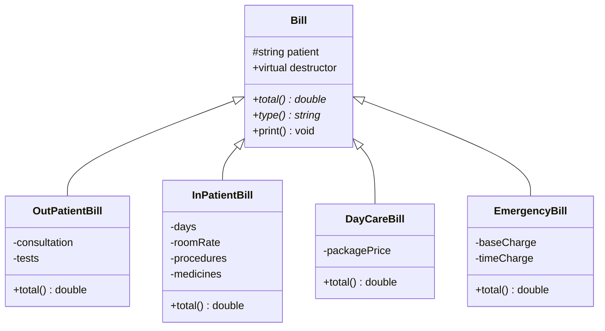

# ASSIGNMENT 5 – CO5
## Reliable Software with Runtime Polymorphism and Exceptions
**Course Outcome:** CO5 – Build robust C++ applications using virtual functions, runtime polymorphism and exception handling.  
**Case Study:** Hospital Billing and Insurance Claims

> Compile with: `g++ -std=c++17 -Wall -Wextra file.cpp -o program`

---

# PART A – DESIGN

## TASK A1 – Design the Polymorphic Bill Hierarchy

### A1.1 Common Interface

Every bill should provide:
- `total()` – calculates the final bill amount.
- `type()` – identifies the bill category.
- `print()` – displays bill details.

Common data: patient name/ID and applicable bill amount.

### A1.2 Class Hierarchy

`Bill` is an abstract class. Derived classes are `OutPatientBill`, `InPatientBill`, `DayCareBill`, and `EmergencyBill`. Each derived class overrides `total()`.



`*` Pure virtual functions. `print()` can be a normal function that calls virtual functions. Derived classes override the pure virtual functions.

### A1.3 Process All Bills – Pseudocode

```text
ALGORITHM DAILY_BILL_TOTAL(bills, n)
    total ← 0
    FOR i ← 0 TO n - 1
        total ← total + bills[i]->total()
    END FOR
    RETURN total
END ALGORITHM
```

### Alternative: One Structure and Switch

Store all possible bill fields in one `Bill` structure and use a type code with `switch` inside `total()`. Processing n bills takes O(n) in either approach; each bill calculation is O(1). The single structure can waste space on unused fields. Adding a new bill type requires changing the switch and possibly the structure, while a derived class can be added to the polymorphic design without changing existing classes.

---

## TASK A2 – Understand Runtime Binding

### A2.1 Early vs Late Binding

- **Early binding:** function call is resolved at compile time. A non-virtual function called through a base pointer uses the base-class implementation.
- **Late binding:** a virtual function called through a base pointer is resolved at runtime based on the actual object type.

Example: `Bill* b = new OPBill; b->total();` calls `OPBill::total()` because `total()` is virtual.

### A2.2 Vtable Concept

Simplified vtables:

```text
Bill vtable
 ├── destructor
 └── total() → pure virtual (no Bill implementation)

OutPatientBill vtable
 ├── destructor → OutPatientBill destructor
 └── total() → OutPatientBill::total()

InPatientBill vtable
 ├── destructor → InPatientBill destructor
 └── total() → InPatientBill::total()
```

When `b->total()` is called, the object's virtual-table pointer selects the derived class's `total()` entry at runtime.

### A2.3 Virtual Destructor

A base class used polymorphically must have a virtual destructor so deleting a derived object through a base pointer calls the derived destructor first, then the base destructor. This prevents undefined behavior and resource leaks.

### Predict the Output

```text
500 ~OPBill ~Bill
```

`show()` is not virtual, but it calls the virtual function `total()`. Virtual dispatch still selects `OPBill::total()` for the actual object. If the base destructor is made non-virtual, deleting the derived object through `Bill*` is undefined behavior; output and sanitizer diagnostics are not guaranteed. Verify the actual result on your compiler.

### Alternative: `dynamic_cast`

If `total()` were non-virtual, code could test the object type with `dynamic_cast` and call each derived total. For k bill types, it may require up to k checks per bill (O(k), with k usually fixed), rather than one virtual call (O(1)). A polymorphic object may carry a vtable pointer; exact layout and size are compiler-dependent.

---

## TASK A3 – Design with Abstract Classes

### A3.1 Payer Interface

```cpp
class Payer {
public:
    virtual double amountCovered(const Bill& b) const = 0;
    virtual ~Payer() = default;
};

class SelfPay : public Payer {
public:
    double amountCovered(const Bill& b) const override {
        return b.total();
    }
};

class Insurance : public Payer {
    double limit, copayPercent;
public:
    Insurance(double l, double c) : limit(l), copayPercent(c) {}
    double amountCovered(const Bill& b) const override {
        double covered = b.total() * (1.0 - copayPercent / 100.0);
        return covered < limit ? covered : limit;
    }
};

class GovernmentScheme : public Payer {
    double packageRate;
public:
    explicit GovernmentScheme(double p) : packageRate(p) {}
    double amountCovered(const Bill&) const override {
        return packageRate;
    }
};
```

### A3.2 Extension

A new `CorporatePayer` can inherit from `Payer` and implement `amountCovered()`. Existing payer classes remain unchanged. A pointer/reference to `Payer` can call the appropriate method through runtime polymorphism.

### Alternative: Function Pointer or `std::function`

A payer policy could be stored as a function pointer or `std::function<double(const Bill&)>`. Each call is O(1), similar to a virtual call. The function object may capture data such as cover limit and co-payment. The abstract class keeps related data and behavior together, while function objects can make policies more flexible but may be harder to organize and validate.

---

## TASK A4 – Design the Exception Strategy

### A4.1 Errors and Exception Hierarchy

Possible errors:
- Negative charges or bill amounts.
- Claim amount exceeding insurance cover.
- Unknown government package.
- Missing patient record.
- Invalid text input for numeric values.
- Memory allocation failure (`std::bad_alloc`).

```text
std::exception
 └── BillingError
     ├── ClaimError
     ├── InvalidChargeError
     ├── PatientNotFoundError
     └── UnknownPackageError
```

### A4.2 Throwing and `noexcept`

Functions that validate amounts, calculate claims, parse inputs, or look up records may throw. Destructors, cleanup functions and simple state-reset operations should be non-throwing where possible and marked `noexcept` when they guarantee it.

Destructors should not throw because an exception during stack unwinding can cause program termination if another exception is already active.

### Alternative: Return Status Codes

Return an enum/status or `bool` and pass an error message to the caller. The normal path is simple and avoids exception handling overhead. The error path requires explicit checks at each call site and extra information to communicate the reason. Time for basic validation is O(1) in either design.

---

## TASK A5 – Design Recovery and Rethrowing

### A5.1 Catching Strategy

- Catch close to the operation only when the program can recover or add useful context.
- Log at the intermediate layer when required, then use `throw;` to rethrow the same exception.
- Catch at the application boundary to report a clear message to the user.
- Use `catch (...)` at the top level only as a final safety boundary.

### A5.2 Stack Unwinding and RAII

When an exception is thrown, C++ unwinds the stack and destroys local objects in reverse construction order. RAII objects such as `std::vector`, `std::string`, file streams and `std::unique_ptr` release their resources through destructors. This prevents leaks when control exits a function unexpectedly.

### Predict the Output

```text
~f ~main caught 42
```

`f()` throws `42`. During unwinding, local `Guard g` is destroyed first (`~f`). Then the `try` scope in `main` is exited and `Guard m` is destroyed (`~main`). The matching `catch(int)` prints `caught 42`. The statement `not printed` is skipped because the throw transfers control to the handler.

### Alternative: Manual `delete` in Catch Blocks

Manual resource release requires a `delete` in every relevant error handler. Time is generally the same, but code grows with each cleanup path. When new error paths are added, each must release every acquired resource; missing one can leak memory. RAII performs cleanup automatically during stack unwinding.

---

# PART B – IMPLEMENTATION & EXPERIMENTAL INVESTIGATION

## TASK B1 – Implement and Validate Polymorphic Billing

### Completed TODOs

**TODO 1 – Bill**
```cpp
virtual double total() const = 0;
virtual std::string type() const { return "Bill"; }
```

**TODO 2 – OutPatient**
```cpp
double total() const override { return consultation + tests; }
std::string type() const override { return "OP"; }
```

**TODO 3 – InPatient**
```cpp
double total() const override { return days * perDay + surgery; }
std::string type() const override { return "IP"; }
```

### Complete Program

```cpp
#include <iostream>
#include <string>

class Bill {
protected:
    std::string patient;
public:
    explicit Bill(const std::string& p) : patient(p) {}
    virtual ~Bill() = default;
    virtual double total() const = 0;
    virtual std::string type() const { return "Bill"; }
    void print() const {
        std::cout << type() << ' ' << patient << ": " << total() << '\n';
    }
};

class OutPatient : public Bill {
    double consultation, tests;
public:
    OutPatient(const std::string& p, double c, double t)
        : Bill(p), consultation(c), tests(t) {}
    double total() const override { return consultation + tests; }
    std::string type() const override { return "OP"; }
};

class InPatient : public Bill {
    int days;
    double perDay, surgery;
public:
    InPatient(const std::string& p, int d, double rate, double s)
        : Bill(p), days(d), perDay(rate), surgery(s) {}
    double total() const override { return days * perDay + surgery; }
    std::string type() const override { return "IP"; }
};

int main() {
    Bill* bills[] = {
        new OutPatient("Ravi", 500, 1200),
        new InPatient("Meena", 3, 2500, 40000)
    };
    double sum = 0;
    for (Bill* b : bills) {
        b->print();
        sum += b->total();
    }
    std::cout << "Total " << sum << '\n';
    for (Bill* b : bills) delete b;
}
```

**Output**
```text
OP Ravi: 1700
IP Meena: 47500
Total 49200
```

### B1.2 Comparison with Part A

The implementation follows the abstract base class and derived bill classes. The `total()` function is pure virtual, and derived classes override it. The base pointer processes both types using runtime polymorphism.

### B1.3 Remove `virtual`

If `total()` is not virtual, the base class cannot provide the pure virtual interface and polymorphic calls through base pointers will not select the derived implementation. The given program will fail to compile if `total()` remains pure virtual without being virtual (pure virtual functions are necessarily virtual). If replaced by a normal non-virtual base function, base-pointer calls use that function instead.

### B1.4 Virtual Destructor

Removing the virtual destructor and deleting derived objects through `Bill*` invokes undefined behavior. The sanitizer may or may not show a report; record the actual compiler/runtime result rather than inventing one.

### Alternative: Templates

Compile-time polymorphism can use templates and separate containers for each bill type. Each call can avoid a virtual dispatch, but separate containers make it harder to store mixed bill types in one collection and process them uniformly. Total processing remains O(n).

---

## TASK B2 – Engineer Error Conditions

### Tests and What They Reveal

| Test | Expected behaviour | What it validates |
|---|---|---|
| Negative charge | `invalid_argument` or custom billing exception | Input validation |
| Claim above cover | `ClaimError` | Claim limit enforcement |
| Unknown package | `UnknownPackageError` | Package validation |
| Text instead of number | `invalid_argument` from parsing | Input parsing |
| Huge allocation | `bad_alloc` (if actually triggered) | Allocation failure handling |
| Top-level `catch(...)` | Error reported, program remains controlled | Final safety boundary |

### Predict the Output

```text
ok done caught negative ok [log too large] caught too large
```

- `100.0`: validation succeeds, prints `ok`, then `process()` returns and main prints `done`.
- `-5.0`: `invalid_argument("negative")` is not caught by the `out_of_range` handler in `process()`, so it reaches the main handler and prints `caught negative`.
- `2e6`: `out_of_range("too large")` is caught in `process()`, logged once, and rethrown using `throw;`. Main catches it and prints `caught too large`.

### Complete the Code – TODO 1 and TODO 2

```cpp
double approve(double billed, double cover) {
    if (billed < 0 || cover < 0)
        throw std::invalid_argument("negative amount");
    if (billed > cover)
        throw ClaimError("exceeds cover");
    return billed;
}

double settle(double billed, double cover) {
    try {
        return approve(billed, cover);
    } catch (const ClaimError& e) {
        std::cout << "audit: " << e.what() << '\n';
        throw;
    }
}
```

### Complete Program

```cpp
#include <iostream>
#include <stdexcept>

class ClaimError : public std::runtime_error {
public:
    using std::runtime_error::runtime_error;
};

double approve(double billed, double cover) {
    if (billed < 0 || cover < 0)
        throw std::invalid_argument("negative amount");
    if (billed > cover)
        throw ClaimError("exceeds cover");
    return billed;
}

double settle(double billed, double cover) {
    try {
        return approve(billed, cover);
    } catch (const ClaimError& e) {
        std::cout << "audit: " << e.what() << '\n';
        throw;
    }
}

int main() {
    double cases[][2] = {{40000, 50000}, {60000, 50000}, {-1, 50000}};
    for (auto& c : cases) {
        try {
            double paid = settle(c[0], c[1]);
            std::cout << "approved " << paid << '\n';
        } catch (const ClaimError& e) {
            std::cout << "claim rejected: " << e.what() << '\n';
        } catch (const std::exception& e) {
            std::cout << "error: " << e.what() << '\n';
        }
    }
}
```

**Expected output**
```text
approved 40000
audit: exceeds cover
claim rejected: exceeds cover
error: negative amount
```

### `throw;` vs `throw e;`

- `throw;` rethrows the currently handled exception without creating a new exception object and preserves its dynamic type.
- `throw e;` throws a new object based on the static type of `e` (in this catch, `ClaimError`), which can slice derived exception types.

### Alternative: `std::optional<double>`

Return a value when the claim is accepted and an empty optional when rejected. For 1,000,000 claims, both approaches have O(n) total processing. With 0% invalid, exceptions are not thrown; with 1% or 50% invalid, exception-based control flow can be more expensive due to throw/catch overhead. `optional` uses space for a value and a presence flag per result; exact size is implementation-dependent.

---

## TASK B3 – Virtual Functions vs Switch vs Exceptions: Cost

### B3.1 Correctness

For 10 bills, calculate the total using both a virtual-function hierarchy and a type-code switch implementation. The totals should be identical. Use the same input values for a fair comparison.

### B3.2 Performance Experiment

Compile optimized versions:
```bash
g++ -std=c++17 -O2 -Wall -Wextra virtual.cpp -o virtual
g++ -std=c++17 -O2 -Wall -Wextra switch.cpp -o switch
```

Measure both implementations with 1,000, 1,000,000 and 10,000,000 bills. Record actual results:

| Bill count | Virtual (time) | Switch (time) |
|---:|---:|---:|
| 1,000 | Run and record | Run and record |
| 1,000,000 | Run and record | Run and record |
| 10,000,000 | Run and record | Run and record |

### B3.3 Exception Cost

Measure 1,000,000 claims with 0%, 1% and 50% invalid input, using return codes and exceptions. Record actual timings:

| Invalid rate | Return-code time | Exception time |
|---:|---:|---:|
| 0% | Run and record | Run and record |
| 1% | Run and record | Run and record |
| 50% | Run and record | Run and record |

### B3.4 Engineering Trade-Off

- Virtual functions are useful for a common interface and extensible runtime object types.
- A switch may be simpler and potentially faster for a fixed set of types, but new types require changing the switch.
- Exceptions are useful for uncommon failures; status values can be useful for frequent expected validation failures.
- Use measured timings from your system before deciding. Do not invent benchmark results.

### Alternative: `std::variant` and `std::visit`

```cpp
using BillVariant = std::variant<OutPatientBill, InPatientBill>;

double total(const BillVariant& b) {
    return std::visit([](const auto& bill) { return bill.total(); }, b);
}
```

Benchmark against the virtual and switch versions for 10,000,000 bills. `variant` stores enough space for its largest alternative plus a discriminator/tag (exact size depends on implementation). It offers type-safe alternatives but all types must be known at compile time.

---

## TASK B4 – Final Engineering Decision

### B4.1 Extension

Add a new derived bill type (for example, `DentalBill`) implementing `total()` and `type()`, and add a new payer (for example, `CorporatePayer`) implementing `amountCovered()`. Existing classes need not be modified.

### B4.2 Resource Safety

Run all success and exception tests with AddressSanitizer:

```bash
g++ -std=c++17 -Wall -Wextra -fsanitize=address -fno-omit-frame-pointer main.cpp -o main
./main
```

Record the actual sanitizer output. A clean run typically finishes without an AddressSanitizer error report; attach the real run screenshot.

### B4.3 Production Decision

The polymorphic design with exceptions is suitable when bill and payer types are expected to grow because new derived classes can be added with minimal changes. Runtime polymorphism provides a common interface for mixed bill types, and RAII reduces resource leaks during failures. Exceptions are appropriate for exceptional conditions, while common expected validation failures may be better handled using return codes. Production use also requires validation, logging, testing, and security controls.

### Alternative: Configuration-Based Plug-ins

Bills and payer rules could be loaded from configuration files. Each bill's rules would be interpreted at runtime, giving flexibility without recompilation. Rule interpretation may take longer per bill than a direct virtual call, though both can be constant-time for simple rules. Configuration uses storage for rules and values. Plug-ins are easier to update but require careful validation and can introduce configuration errors; C++ classes are more strongly checked but require rebuilding to extend.

---

# GITHUB SUBMISSION CHECKLIST

- [ ] Create repository: `DSA01-<RegisterNumber>-Assignment5`
- [ ] Create folders `Task01` to `Task06` (or Part A and Part B folders)
- [ ] Upload runnable `.cpp` files for every implementation task
- [ ] Include input files and genuine output screenshots
- [ ] Add `README.md` with name, register number, compiler/version, compile command and run steps
- [ ] Commit progressively—at least one commit per task
- [ ] Add the GitHub repository link to the report and submit it

**Important:** This document provides design answers, predictions, code and expected outputs. The assignment also requires actual execution, timing measurements, sanitizer reports and screenshots. Run the experiments on your own compiler and replace the measurement tables with your real results before submission.
